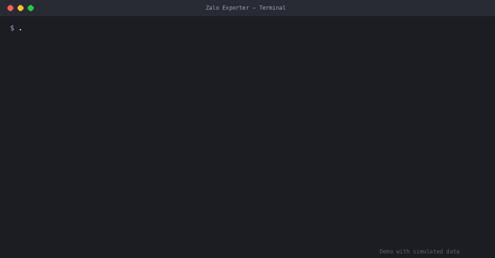

# Zalo Exporter

[English](README.md) · **Tiếng Việt**


*Demo với dữ liệu giả lập: tên nhóm là bịa, không phải cuộc trò chuyện thật.*

Lưu tin nhắn của các nhóm Zalo bạn chọn vào **chính máy tính của bạn**, từ **Zalo trên máy tính** hoặc từ **Zalo Web**, để bạn thấy những câu hỏi nào xuất hiện nhiều nhất và làm báo cáo. Chạy được trên **Windows và Mac**. **Không cần cài đặt gì.**

## Bắt đầu

| Máy | Giải nén đúng file zip, rồi bấm đúp |
|---|---|
| Windows | `Export.bat` |
| Mac | `Export.command` (lần đầu: bấm chuột phải → Open) |

Một cửa sổ sẽ hỏi vài điều **một lần duy nhất** (ngôn ngữ, một phần tên nhóm, có ẩn tên thật hay không) rồi hiện menu:

```
1  Lấy tin nhắn MỚI từ Zalo trên máy tính         (lần đầu: lấy tất cả những gì có)
2  Lấy tin nhắn MỚI từ Zalo Web                   (chỉ khoảng 14 ngày gần nhất)
3  Đọc lại TOÀN BỘ lịch sử từ Zalo trên máy tính   (một lần, sau khi điện thoại đồng bộ xong)
4  Đọc lại toàn bộ tin nhắn có sẵn từ Zalo Web
5  Kiểm tra công cụ có thấy Zalo không             (không xuất dữ liệu)
6  Đổi cài đặt (ngôn ngữ, tên nhóm, ẩn tên)
```

Bấm Enter để lặp lại lựa chọn lần trước. Khi chạy, một dòng hiển thị tiến độ, và mỗi nhóm đọc xong sẽ có một dòng ✓. Cuối cùng có bản tóm tắt và vị trí của tệp kết quả.

## Nên dùng nguồn nào?

- **Zalo trên máy tính (1 và 3):** lịch sử đầy đủ, nhưng chỉ gồm những gì Zalo trên máy đã đồng bộ từ điện thoại. Công cụ tắt Zalo, mở lại ở chế độ xuất, và mở lại bình thường khi xong. **Không dùng Zalo khi công cụ đang chạy.**
- **Zalo Web (2 và 4):** chỉ khoảng 14 ngày gần nhất. Công cụ mở cửa sổ Chrome hoặc Edge **riêng**, nên trình duyệt thường ngày của bạn không bị đụng đến. Lần đầu: quét mã QR bằng ứng dụng Zalo trên điện thoại; lần đăng nhập được nhớ trong thư mục `web-profile`.
- Cả hai cùng ghi vào **một kho lưu trữ** và không lưu trùng tin nhắn, nên bạn có thể dùng xen kẽ.

## Mỗi 1 đến 2 tuần

Chạy lại và bấm Enter. Công cụ chỉ đọc tin nhắn **mới** (vài phút). Một lần, sau khi điện thoại đã đồng bộ xong, hãy chọn **3** để đọc lại toàn bộ.

## Kết quả nằm ở đâu

| Tệp | Nội dung |
|---|---|
| `archive/archive.json` | Toàn bộ tin nhắn, chia theo nhóm, không trùng. Tên là mã (khi bật "ẩn tên"). |
| `archive/archive_real-names.json` | Giống trên nhưng có tên thật (chỉ khi tắt "ẩn tên"). Để riêng để hai loại không bị lẫn. |
| `archive/names_PRIVATE.json` | Tên thật ứng với các mã ẩn danh. **Chỉ giữ trên máy này. Không gửi đi.** |
| `settings.json` | Ngôn ngữ, tên nhóm và khóa bí mật tạo ra các mã. **Không xóa**, nếu không các mã sẽ bị đổi. |
| `web-profile/` | Phiên đăng nhập Zalo Web đã lưu (chỉ khi dùng Zalo Web). Giữ riêng tư. |

## Quyền riêng tư và rủi ro

- **Ẩn tên là tùy chọn** (mục 6 trong menu). Khi bật, tên nhóm và tên người được thay bằng mã (`C…` cho nhóm, `U…` cho người). Khi tắt, tên thật được lưu: hãy giữ tệp riêng tư. Đổi chế độ sẽ tạo một kho lưu trữ riêng; kho còn lại không bị thay đổi.
- Kể cả khi đã ẩn tên, tên viết **trong nội dung** tin nhắn (tên gọi, biệt danh) **không** bị che. Hãy coi mọi tệp là dữ liệu nhạy cảm và xin phép phụ huynh trước khi phân tích tin nhắn của họ.
- Công cụ đọc màn hình Zalo giống như một người dùng. Đây là công cụ không chính thức; Zalo có thể thay đổi ứng dụng làm công cụ ngừng hoạt động, và việc dùng tự động hóa có thể không phù hợp với điều khoản của Zalo. Hãy tự chịu rủi ro khi sử dụng.
- Ở chế độ Zalo trên máy tính, Zalo mở một "cổng gỡ lỗi" trên máy trong lúc công cụ chạy, cho phép chương trình khác trên máy này điều khiển nó. Vì vậy Zalo được mở lại bình thường khi xong.

## Nếu có lỗi

- Chọn **5** (kiểm tra) rồi gửi toàn bộ chữ trong cửa sổ cho người phát triển.
- Dòng như `! <tên nhóm> không mở được (thường do chưa đồng bộ về máy này)` nghĩa là tin nhắn của nhóm đó chưa có trên máy. Sau khi điện thoại đồng bộ xong, hãy chạy lại và chọn 3.
- **Windows** có thể cảnh báo khi chạy tệp `.bat` tải về: chọn "Run anyway", hoặc bấm chuột phải vào file zip → Properties → Unblock trước khi giải nén.
- **Mac** có thể chặn lần mở đầu: bấm chuột phải `Export.command` → Open → Open. Hoặc chạy `xattr -dr com.apple.quarantine <thư mục>` trong Terminal.
- Không tìm thấy Zalo (Windows): công cụ sẽ hỏi đường dẫn một lần (bấm chuột phải biểu tượng Zalo → Properties → sao chép mục **Target**).

## Dành cho người phát triển

Xem phần "For the developer" trong [README.md](README.md).
